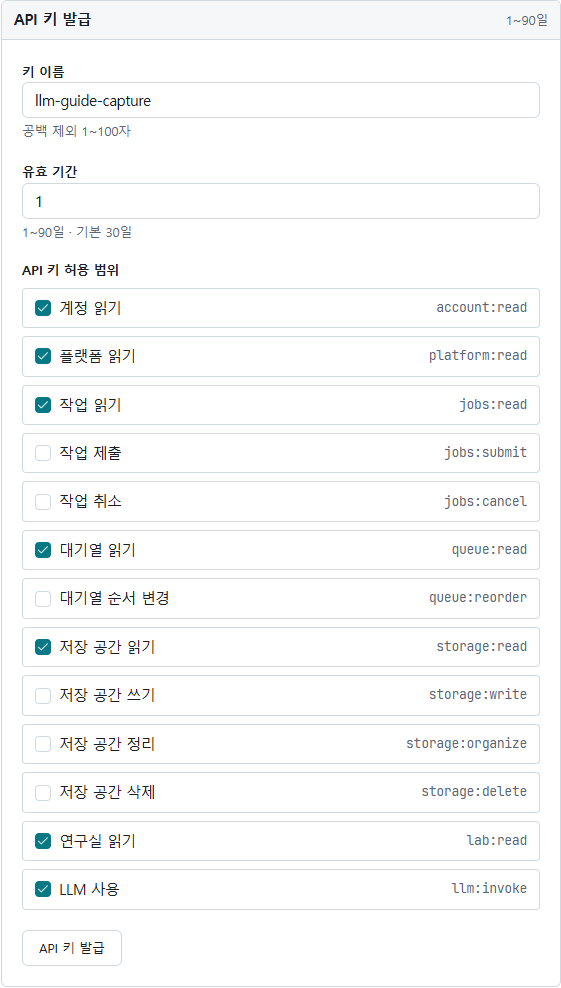
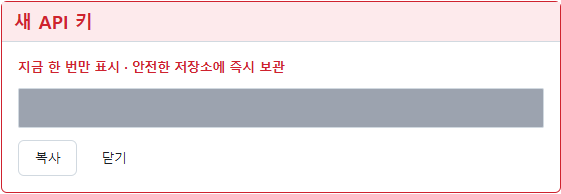
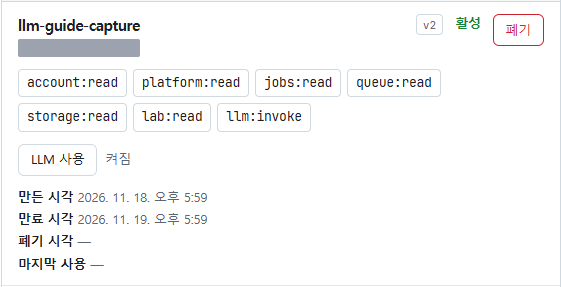

LLM은 JPUShare API 키로 부릅니다. 키가 없으면 1절부터, 이미 키가 있으면 2절부터 따라 합니다. 연구실 참가 승인을 마친 구성원만 쓸 수 있습니다. 아직이라면 먼저 [웹 시작하기](/JPUShare/1Web/1GettingStarted)를 마칩니다.

## 1. 새 키로 시작하기



1. [JPUShare](https://share.jedutools.io)에 로그인합니다.
2. 왼쪽 위의 **내 정보/설정**을 엽니다.
3. **API 키 발급** 판에 키 이름과 유효 기간(1~90일)을 입력합니다.
4. **API 키 허용 범위**에서 **LLM 사용**(`llm:invoke`)을 체크합니다. 처음에는 체크되어 있지 않습니다. 다른 범위는 LLM 호출과 관계없으니, 필요 없으면 해제해도 됩니다.
5. **API 키 발급**을 누릅니다.
6. **새 API 키** 판에 한 번만 보이는 `jpk_...` 원문을 **복사**해 안전한 곳에 보관합니다.



> 키 원문은 다시 볼 수 없습니다. 잃어버렸으면 그 키를 폐기하고 새로 발급합니다.

## 2. 이미 키가 있다면

[에이전트 연결하기](/JPUShare/2Agent/1Connect) 등으로 이미 받은 키가 있으면, 새로 발급하지 않고 그 키에 LLM을 켤 수 있습니다. 키 값은 바뀌지 않으므로 쓰던 설정을 그대로 씁니다.



1. **내 정보/설정**의 **발급 기록** 판에서 쓸 키를 찾습니다.
2. 키 줄의 **LLM 사용** 버튼을 누릅니다.
3. 버튼 옆 글자가 **켜짐**으로 바뀌고, 허용 범위 목록에 `llm:invoke`가 생기면 끝입니다.

| 이렇게 보이면 | 뜻과 대처 |
|---|---|
| **LLM 사용** 버튼을 누를 수 없고 **새 키 발급 필요**가 보임 | 예전 방식(v1) 키입니다. 1절대로 새 키를 발급합니다. |
| 「연구실 구성원만 LLM 을 켤 수 있습니다.」 | 연구실 참가 승인 전입니다. [웹 시작하기](/JPUShare/1Web/1GettingStarted)를 먼저 마칩니다. |
| 키 줄에 **LLM 사용** 버튼이 없음 | 폐기되었거나 만료된 키입니다. 새 키를 발급합니다. |

LLM 켜기·끄기는 웹에 로그인해서만 할 수 있습니다. 끄면 그 키로 LLM을 부를 수 없고, 다른 범위는 그대로 남습니다. 범위가 **LLM 사용** 하나뿐인 키는 끌 수 없으니, 그 키는 폐기합니다.

## 3. 키 넣기

키는 환경 변수로 넣고, 코드에 직접 적지 않습니다.

```bash
export JPUSHARE_API_KEY='jpk_...'
```

> 키 원문을 채팅·문서·저장소에 붙여 넣지 마세요. 대화 기록이나 커밋에 그대로 남습니다.

## 4. 연결 확인하기

모델 목록을 받아 봅니다.

```bash
curl -sS https://share.jedutools.io/v1/llm/models \
  -H "Authorization: Bearer $JPUSHARE_API_KEY"
```

`"object":"list"`와 함께 `auto`, `qwen3.6-35b-a3b` 같은 모델 이름이 오면 준비가 끝났습니다. 401이면 키 원문을 다시 확인하고, 403 `API_KEY_SCOPE_REQUIRED`이면 그 키에 **LLM 사용**이 켜져 있는지 확인합니다.

## 5. 첫 질문 보내기

### curl

```bash
curl -sS https://share.jedutools.io/v1/llm/chat/completions \
  -H "Authorization: Bearer $JPUSHARE_API_KEY" \
  -H "Content-Type: application/json" \
  -d '{
    "model": "auto",
    "messages": [{"role": "user", "content": "한 문장으로 자기소개해 줘."}],
    "max_tokens": 256,
    "chat_template_kwargs": {"enable_thinking": false}
  }'
```

답은 `choices[0].message.content`에 있습니다. 응답의 `model`에서 실제로 답한 모델을 확인할 수 있습니다.

### Python(OpenAI 라이브러리)

`pip install openai`로 라이브러리를 먼저 설치합니다.

```python
import os
from openai import OpenAI

client = OpenAI(
    base_url="https://share.jedutools.io/v1/llm",
    api_key=os.environ["JPUSHARE_API_KEY"],
)
resp = client.chat.completions.create(
    model="auto",
    messages=[{"role": "user", "content": "한 문장으로 자기소개해 줘."}],
    max_tokens=256,
    extra_body={"chat_template_kwargs": {"enable_thinking": False}},
)
print(resp.model, resp.choices[0].message.content)
```

다른 OpenAI 호환 도구에서는 주소(base URL)에 `https://share.jedutools.io/v1/llm`을, API 키에 `jpk_...` 원문을 넣습니다. `"stream": true`로 답을 나눠 받을 수도 있습니다. 제공하는 것은 모델 목록과 채팅(chat completions)이고, 임베딩 같은 다른 경로는 없습니다.

> 생각 모드가 기본으로 켜진 모델이 있습니다. 위 예시처럼 끄지 않으면 답 앞에 긴 생각을 먼저 만들고, `max_tokens`가 작으면 본문이 빈 채로 끝납니다. 자세한 것은 [모델과 사용 규칙](/JPUShare/3LLM/2Models)을 봅니다.

[JPUShare 안내로 돌아가기](/JPUShare)
